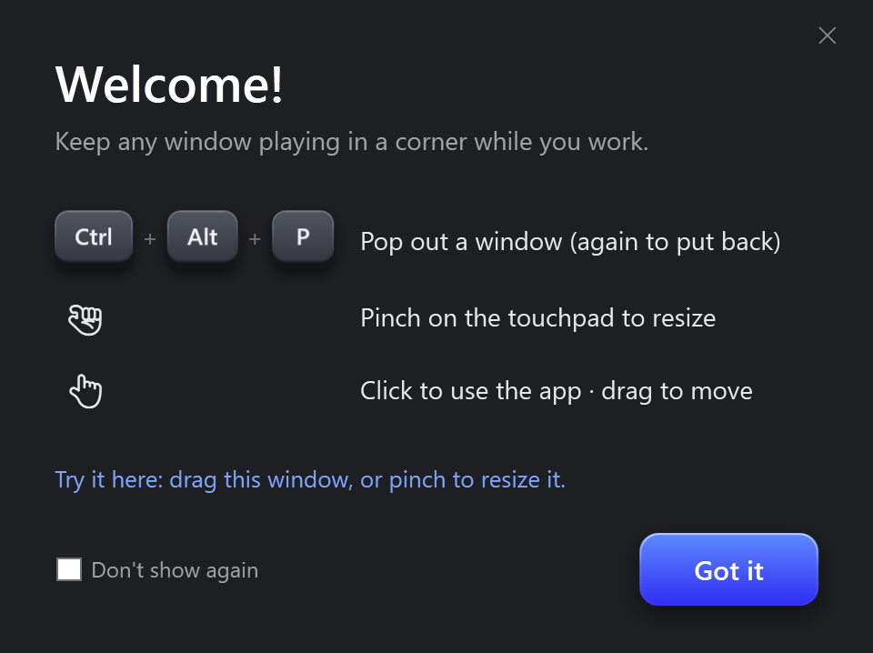

<p align="center">
  
</p>

<h1 align="center">Mini Player</h1>

<p align="center">
  Picture-in-picture for <b>any</b> Windows app.<br>
  Pop a window into a small always-on-top player, keep watching, keep working.
</p>

<p align="center">
  <a href="https://github.com/iamjorj/mini-player/releases/latest"><b>Download for Windows</b></a>
</p>

---

Browsers have picture-in-picture for videos. Mini Player does it for every window: YouTube in Chrome, a Twitch stream, a video call, a game, a terminal, a live dashboard. The video stays live, and you can still click and type in it.

<p align="center">
  
</p>

## How to use

| Action | How |
| --- | --- |
| **Pop out a window** | Focus it, press <kbd>Ctrl</kbd> + <kbd>Alt</kbd> + <kbd>P</kbd> |
| **Put it back** | Press <kbd>Ctrl</kbd> + <kbd>Alt</kbd> + <kbd>P</kbd> again |
| **Resize** | Pinch on the touchpad, scroll the mouse wheel, or drag an edge |
| **Move** | Drag the mini player |
| **Use the app** | Click it: pause, skip, scroll, type, it all goes to the real app |
| **More options** | Right-click: *Back to app* or *Close mini player* |

The mini player starts in the bottom-right corner and keeps the window's shape. Mini Player lives in the system tray; right-click the tray icon to exit.

## Download

1. Get **`MiniPlayer.exe`** from the [latest release](https://github.com/iamjorj/mini-player/releases/latest).
2. Run it. Nothing to install, and you don't need .NET.
3. Windows may say *"Windows protected your PC"* because the app isn't code-signed yet. Click **More info → Run anyway**.

To start it with Windows, press <kbd>Win</kbd> + <kbd>R</kbd>, type `shell:startup`, and put a shortcut to `MiniPlayer.exe` in that folder.

## Requirements

- Windows 10 or 11, 64-bit
- A precision touchpad for pinch-to-resize (the mouse wheel works everywhere)

## Good to know

- One window at a time. Press the hotkey again to put it back before popping out another.
- While a window is popped out, the original stays where it was but is invisible and lets clicks pass through. It comes back exactly as it was when you close the mini player, and also after a crash the next time Mini Player starts.
- Windows running as administrator can't be controlled by a normal app, so they may not pop out. Run Mini Player as administrator if you need that.
- If <kbd>Ctrl</kbd> + <kbd>Alt</kbd> + <kbd>P</kbd> is already taken by another app, Mini Player tells you on startup.
- Problems are logged to `%TEMP%\MiniPlayer.log`.

## Build from source

You need the [.NET 8 SDK](https://dotnet.microsoft.com/download/dotnet/8.0).

```bash
git clone https://github.com/iamjorj/mini-player.git
cd mini-player
dotnet run
```

To build the single standalone `.exe`:

```bash
dotnet publish -c Release -r win-x64 --self-contained true -p:PublishSingleFile=true -p:IncludeNativeLibrariesForSelfExtract=true -p:EnableCompressionInSingleFile=true -p:DebugType=none -o publish
```

## How it works

- **Live picture:** the mini player shows the window through a DWM thumbnail, the same live preview Windows uses for taskbar hovers. No screen capture, so it's cheap and sharp.
- **Video keeps playing:** Chrome and Edge pause drawing when a window is covered. Mini Player keeps the original window on top but fully transparent, so the browser never thinks it's hidden.
- **Smooth pinch:** touchpad gestures come straight from Windows DirectManipulation, and each resize is synced to the screen's refresh rate.
- **Click-through:** when you click the mini player, the invisible original is lined up under your cursor, so clicks and typing land in the right place.

Written in C# with WPF and plain Win32.

## License

[MIT](LICENSE) © iamjorj
